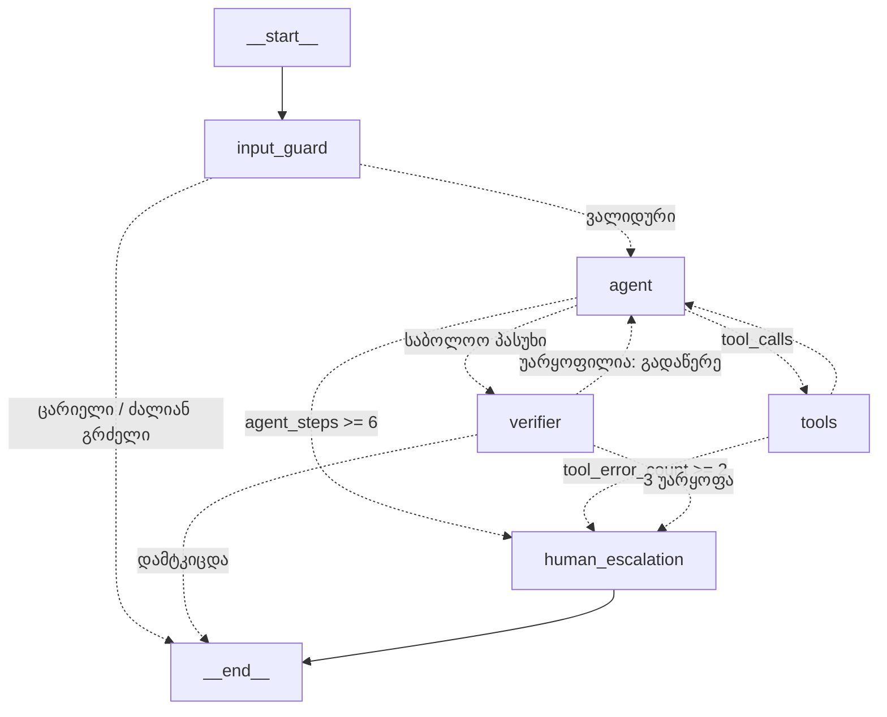

# 🏨 Hotel Voice Agent (LangGraph + Claude)

ქართულენოვანი სასტუმროს ხმოვანი ასისტენტი, აგებული **LangGraph**-ზე:
Tool-ების გამოძახება (PMS), შეცდომების უსაფრთხო დამუშავება, პასუხების თვითშემოწმება (Self-check),
შეკვეთის დადასტურება (Human-in-the-loop), საუბრის მეხსიერება და ადამიანთან გადამისამართება (Human Escalation).



## უსაფრთხოება და ციკლები

| დაცვა | სად | რას აკეთებს |
|---|---|---|
| შეტანის ვალიდაცია | `input_guard` | ცარიელი ან 800 სიმბოლოზე გრძელი შეტანა LLM-მდე არ მიდის; ყოველ შეკითხვაზე მთვლელები ნულდება |
| ციკლის ლიმიტი | `route_after_agent` | მაქსიმუმ 6 LLM-ის გამოძახება ერთ შეკითხვაზე, მერე ადმინისტრატორი (უსასრულო ციკლის / ხარჯის დაცვა) |
| ხელსაწყოს ვალიდაცია | `tools.py` | რაოდენობა 1–10 (pydantic); ოთახის ნომერი State-იდან (`InjectedToolArg`), არა LLM-ისგან |
| შეკვეთის დადასტურება | `tool_node` → `interrupt()` | გრაფი ჩერდება და სტუმარს ეკითხება „გავაფორმო?“; „არა“-ზე შეკვეთა არ ფორმდება |
| Self-check | `verifier` | ჯერ იაფი შემოწმება (markdown, სიგრძე), მერე Claude ამოწმებს მოგონილ კერძებს/ფაქტებს და prompt injection-ს; უარყოფილი პასუხი ისტორიიდან იშლება და აგენტი თავიდან წერს |
| მეხსიერება | `InMemorySaver` + `thread_id` | საუბარი გრძელდება რამდენიმე შეკითხვაზე |
| Prompt injection | `SYSTEM_PROMPT` + verifier | მოდელი უარს ამბობს წესების შეცვლაზე/გამჟღავნებაზე; მთავარი ზღვარი მაინც ხელსაწყოებშია |

## სტრუქტურა

| ფაილი | აღწერა |
|---|---|
| [src/state.py](src/state.py) | `HotelAgentState`: საუბრის ისტორია (`add_messages` reducer), ოთახი, მთვლელები |
| [src/tools.py](src/tools.py) | იმიტირებული PMS ხელსაწყოები: `order_room_service`, `get_wifi_info` |
| [src/graph.py](src/graph.py) | კვანძები, პირობითი განშტოებები, ლიმიტები, დაკომპილირებული `hotel_graph` |
| [src/voice_pipeline.py](src/voice_pipeline.py) | `GuestSession`: საუბარი მეხსიერებით და დადასტურებით; პასუხი იჭრება წინადადებებად TTS-ისთვის |
| [hotel_voice_agent_guide.ipynb](hotel_voice_agent_guide.ipynb) | სრული სასწავლო გიდი ნულიდან |

## გაშვება

```bash
python -m venv venv && source venv/bin/activate
pip install -r requirements.txt
cp .env.example .env   # ჩაწერეთ თქვენი ANTHROPIC_API_KEY

python -m src.voice_pipeline   # ინტერაქტიული საუბარი ტერმინალში
```
