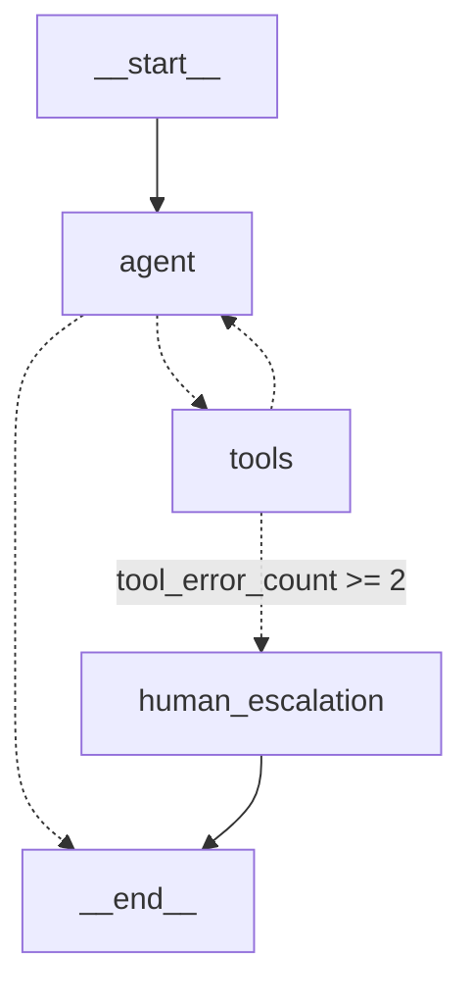

# 🏨 Hotel Voice Agent (LangGraph + Claude)

ქართულენოვანი სასტუმროს ხმოვანი ასისტენტი, აგებული **LangGraph**-ზე:
Tool-ების გამოძახება (PMS), შეცდომების უსაფრთხო დამუშავება, ადამიანთან გადამისამართება (Human Escalation) და წინადადებების დონეზე სტრიმინგი TTS-ისთვის.



## სტრუქტურა

| ფაილი | აღწერა |
|---|---|
| [src/state.py](src/state.py) | `HotelAgentState`: საუბრის ისტორია (`add_messages` reducer), ოთახი, შეცდომების მთვლელი |
| [src/tools.py](src/tools.py) | იმიტირებული PMS ხელსაწყოები: `order_room_service`, `get_wifi_info` |
| [src/graph.py](src/graph.py) | კვანძები, პირობითი განშტოებები, დაკომპილირებული `hotel_graph` |
| [src/voice_pipeline.py](src/voice_pipeline.py) | `stream_sentences()`: LLM ტოკენები → სრული წინადადებები TTS-ისთვის |
| [hotel_voice_agent_guide.ipynb](hotel_voice_agent_guide.ipynb) | სრული სასწავლო გიდი ნულიდან |

## გაშვება

```bash
python -m venv venv && source venv/bin/activate
pip install -r requirements.txt
cp .env.example .env   # ჩაწერეთ თქვენი ANTHROPIC_API_KEY

python -m src.voice_pipeline
```
